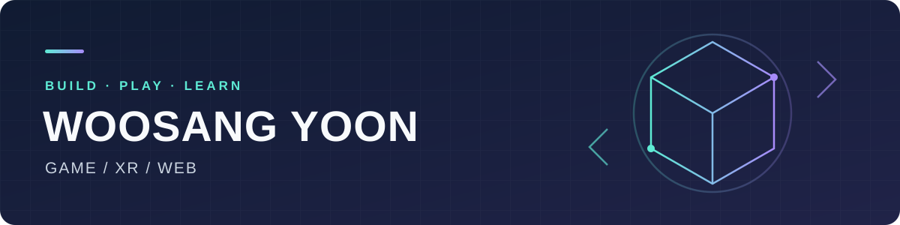

### 안녕하세요, 윤우상입니다 👋

Unity로 게임과 AR·VR 경험을 만들고, 웹과 앱으로 개발 영역을 넓혀가고 있습니다. 
직접 만들고 배우며, 프로젝트와 학습 과정을 이곳에 기록합니다.

---

## 🧭 이런 프로젝트를 만들고 있습니다

- **게임** — VR 리듬 액션, 좀비 생존 슈터, 모바일 생존 회피, 2D 대시 플랫포머
- **AR·VR** — 이미지 인식 동물 앱과 한국 전통놀이 VR 체험
- **앱·웹** — 리뷰 기반 RAG 챗봇, React 기반 토스 미니앱과 Unity 이미지 검색 UI

## 🛠️ 프로젝트에서 사용하는 기술

**게임 · XR**

**웹 · AI · 미니앱**

## 🎮 게임 · AR · VR 프로젝트

| 프로젝트 | 내용 | 기술 | 비고 |
| :--- | :--- | :--- | :--- |
| [UrbanSurvival](https://github.com/ssa25879/UrbanSurvival) | 탑뷰 좀비 생존 슈터. 무기 4종, 보스·무한 모드와 보스 연습, Android 자동 조준·트윈 스틱 조작 | Unity · C# · URP | PC · Android · **업데이트 진행 중** 기존 URP_ZombieGame을 업데이트한 공개용 저장소 |
| [VRRhythmGame](https://github.com/ssa25879/VRRhythmGame) | 세이버로 노트를 베는 VR 리듬 게임. 방향·속도 판정, 점수·콤보·HP, 스테이지 선택과 결과 화면 | Unity · C# · OpenXR | 프로토타입 · Meta Quest 3S · [포트폴리오](https://github.com/ssa25879/VRRhythmGame/blob/main/Docs/Portfolio.md) · [시연 영상](https://youtu.be/3g2RF_wvLGw) |
| [BlockDodge](https://github.com/ssa25879/BlockDodge) | 탄막을 피하는 생존 회피 게임. 조이스틱 이동, 무적 회피·쿨다운, 시간 기반 난이도와 최고 기록 | Unity · C# · URP | Android |
| [2DFlatformerGame](https://github.com/ssa25879/2DFlatformerGame) | 마우스 방향 대시 중심 2D 플랫포머. 대시 재충전, 함정·목표 판정, 스테이지 선택과 순차 잠금 해제 | Unity · C# · 2D Tilemap | 프로토타입 |
| [ARBook](https://github.com/ssa25879/VRBook) | 이미지 인식으로 3D 동물 표시. 트래킹 상태에 따른 표시·숨김, 터치 시 울음소리 재생 | Unity · C# · AR Foundation | Android · 저장소명: VRBook · [구현 설명](https://github.com/ssa25879/VRBook/blob/main/Assets/Scripts/README.md) |

## 🚀 출시한 앱

토스에서 출시한 미니앱입니다.

| 프로젝트 | 내용 | 기술 | 비고 |
| :--- | :--- | :--- | :--- |
| [냉털픽 (ait-FridgePick)](https://github.com/ssa25879/ait-FridgePick) | 보유 재료로 주재료 매칭률 60% 이상인 레시피를 추천하고 부족한 재료를 표시하는 토스 미니앱 (현재 저장소 수정작업중)| React · TypeScript · Vite · Toss TDS · Apps in Toss | **출시 완료** · 식약처·EPIS 레시피 1,359개 레시피 수 확인: 2026-10-13 |
| [턴캘 (ait-TurnCal)](https://github.com/ssa25879/ait-TurnCal) | 교대근무 패턴으로 월간 근무표 자동 계산. 오늘·내일 근무 요약, 날짜별 메모·공휴일 표시 근무 유형 이름·약어·색 편집, 이전 패턴 불러오기와 월간 근무표 PNG·캘린더 파일(.ics) 내보내기 | React · TypeScript · Vite · Toss TDS · Apps in Toss | **v1.2 출시 완료 (2026-10-19)** · 데이터 기기 내 저장 |

## 🌐 앱 · 웹 프로젝트

| 프로젝트 | 내용 | 기술 | 비고 |
| :--- | :--- | :--- | :--- |
| [쇼핑 리뷰 AI 분석기 (review-chatbot)](https://github.com/ssa25879/review-chatbot) | 상품 리뷰를 의미 검색해 질문에 답하고 근거 리뷰를 함께 보여 주는 RAG 챗봇. 리뷰·대화 기록 저장 | Next.js · React · TypeScript · LangChain · Pinecone · Supabase | Mock·실데이터 모드 지원 Gemini 또는 로컬 Ollama로 답변 생성 |
| [UsingAI-ImageSearchApp](https://github.com/ssa25879/UsingAI-ImageSearchApp) | Pixabay·Mock 검색 전환과 비동기 썸네일 로딩을 갖춘 세로형 이미지 검색 UI 앱 | Unity · C# · UI Toolkit · UniTask | Editor 검색 UI 구현 · 모바일 배포 준비 필요 모바일 빌드는 Mock 검색 |
| [포트폴리오 웹사이트](https://github.com/ssa25879/ssa25879.github.io) | 자기소개와 프로젝트를 정리한 개인 포트폴리오. 프로젝트 상세 보기, 반응형 레이아웃과 다크모드 | HTML · CSS · JavaScript | [사이트 보기](https://ssa25879.github.io/) |

## 📚 학습 기록

기초 언어부터 엔진 활용까지, 수업과 실습 내용을 저장소로 정리합니다.

| 분야 | 저장소 | 학습 내용 |
| :--- | :--- | :--- |
| Unreal · C++ | [UnrealPractice](https://github.com/ssa25879/UnrealPractice) | Unreal Engine C++ 실습 |
| C | [Polytech_C_basic](https://github.com/ssa25879/Polytech_C_basic) | C 기초 수업 기록 |
| Java | [polytech_java2](https://github.com/ssa25879/polytech_java2) | 수업·과제용 포크 저장소 |
| C# | [csharp-sourse-2026](https://github.com/ssa25879/csharp-sourse-2026) | 객체지향, 프로퍼티, 상속과 다형성 |
| 디버깅 | [csharp-debug-exam](https://github.com/ssa25879/csharp-debug-exam) | 오류 분석과 수정 실습용 저장소 |

## 🚧 현재 작업 중

현재 개발하고 있는 프로젝트입니다.

| 프로젝트 | 내용 | 기술 | 비고 |
| :--- | :--- | :--- | :--- |
| [ModooTraditionalPlay](https://github.com/ssa25879/ModooTraditionalPlay) | 장구 리듬·사방치기, 체험 공간 이동과 문 상호작용을 다루는 한국 전통놀이 VR 협업 프로젝트 | Unity · C# · XR Interaction Toolkit | 현재 담당: 메인 로비 · 로비 내 상호작용 |

---

<b>직접 만들고, 배우고, 기록합니다.</b>  
<a href="mailto:ssaqwe123@gmail.com">ssaqwe123@gmail.com</a> · <a href="https://github.com/ssa25879?tab=repositories">전체 프로젝트 둘러보기</a>

